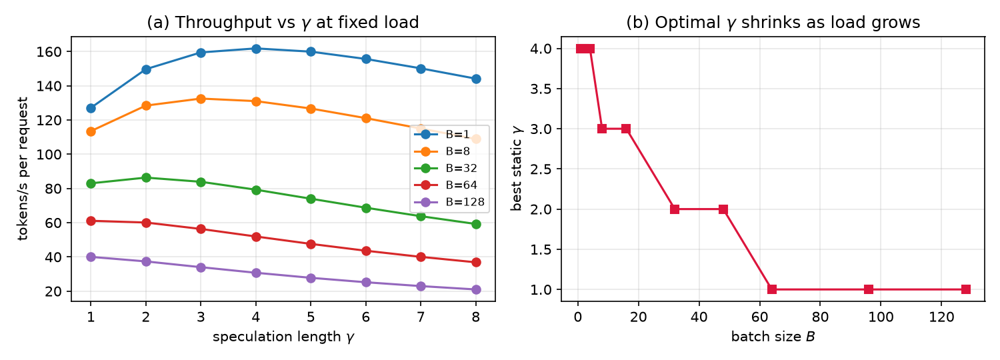
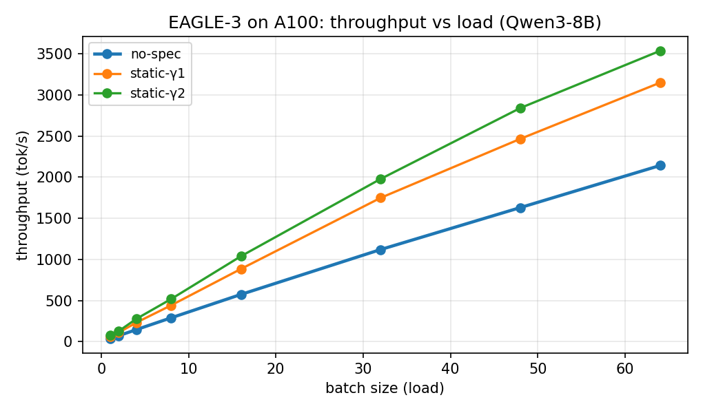
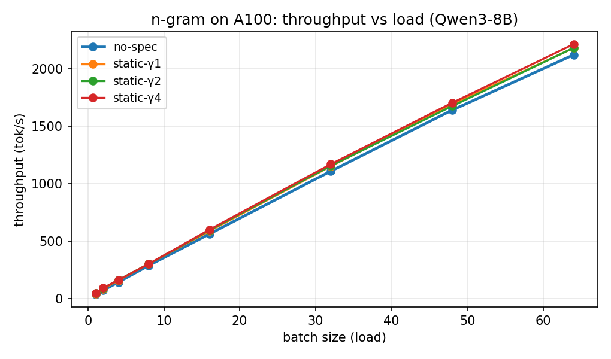
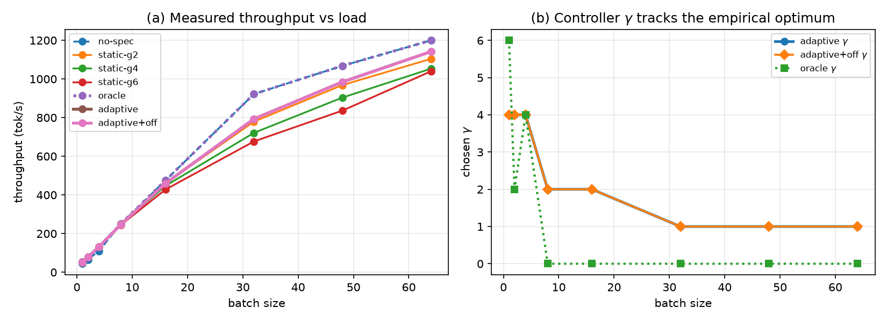
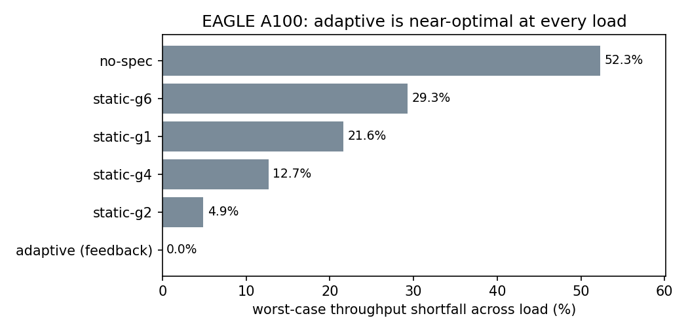
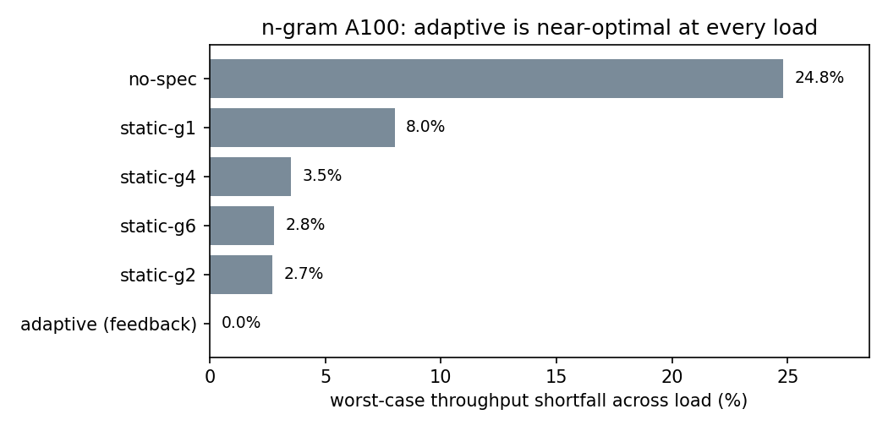

<!-- Convert: `npx @marp-team/marp-cli reports/final_presentation.md --pptx` (notes
 below each slide become PowerPoint presenter notes). Replace (figure:...) lines
 with your results_hw/ PNGs. -->

# Goodput-Aware Adaptive Speculative Decoding
### for Batched LLM Serving

Vaishnavi Athrey Ramesh and Aritra Raychaudhuri, Carnegie Mellon University

**CMU 11-868 LLM Systems**

Real-hardware study: V100 + A100 · n-gram + EAGLE-3 · vLLM 0.11.0

<!--
Speaker: One-line hook "Speculative decoding has a knob, gamma, that everyone sets
once and forgets. We show that's leaving a lot on the table, and that the right gamma
is a scheduling decision that depends on load, drafter, and even which GPU you're on."
Say upfront this is a *real hardware* study on two GPUs, not just simulation.
-->

---

## The problem

- **Speculative decoding:** a small *drafter* proposes `γ` tokens, the big *target*
 verifies them in one pass → several tokens per forward pass.
- Speedup depends on speculation length **`γ`** and acceptance **`α`**.
- **Low load (small batch):** GPU memory-bound, idle compute → long `γ` is ~free.
- **High load (large batch):** GPU compute-bound → long `γ` *wastes* compute, hurts TPOT.
- **Yet vLLM (and others) fix `γ` as a static flag.**

> Thesis: the best `γ` is a **scheduling decision**, not a hyperparameter.

<!--
Speaker: Make the intuition physical. At batch 1 the GPU is starved for work, so
verifying a few extra speculative tokens costs almost nothing. At batch 64 the GPU is
busy, every speculative token you verify but then reject is pure waste that also inflates
tail latency (TPOT). The tension is load-dependent, but the flag is static. That gap is
our opportunity.
Likely Q: "Isn't a good fixed gamma enough?" Answer: it depends on the regime, we'll
show a case (V100) where the best fixed gamma is 15% off the per-load optimum.
-->

---

## Idea: adapt `γ` online to maximize goodput

Pick `γ` each step to maximize **accepted tokens per unit GPU time**:

$$\gamma^* = \arg\max_\gamma \, \frac{E[\text{tokens}\mid \alpha,\gamma]}{t_\text{macro}(B,\gamma)}$$

- `E[tokens | α,γ] = (1−α^{γ+1})/(1−α)` (Leviathan et al. 2023)
- `t_macro(B,γ) = γ·t_draft(B) + t_mem + t_flop·B·(γ+1)`

**Goodput-aware** = useful tokens/s, equivalently req/s under a TPOT SLO.

<!--
Speaker: Numerator = expected tokens emitted (grows with gamma, saturates with acceptance).
Denominator = time for the macro-step, which grows with batch*(gamma+1). So the objective
automatically backs off gamma when the batch is large. "Goodput" rather than raw
throughput because we care about tokens delivered *within an SLO* a server metric.
Q: "Why not just maximize throughput?" Because at high load raw throughput and SLO
attainment diverge, goodput captures the latency constraint.
-->

---

## Roofline analysis *guided the design*

Because `t_macro ∝ B·(γ+1)·t_flop`, the cost penalizes long speculation exactly when
the batch is large:

- **`γ*` shrinks as batch `B` grows**
- **`γ*` grows as acceptance `α` grows**

⇒ **No single static `γ` is optimal across a load sweep.** This closed-form prediction is
the hypothesis we test on hardware.

<!--
Speaker: This is the "roofline/bottleneck analysis before implementing" the rubric asks
for. We derived the prediction FIRST, then built the controller to exploit it, then
tested it on hardware. Point at the right panel: optimal gamma steps down from ~4 to 1 as
batch grows. Everything after this slide is checking whether real GPUs behave this way.
-->

---

## Method: two controllers

**1. Cost-model controller** (model-based)
- EWMA estimate of `α`, pick `γ*` via the roofline objective with **calibrated** constants.
- Needs only: running batch size, online `α`, cost model all available to a scheduler.

**2. Throughput-feedback controller** (model-free)
- Per load, learn the **measured tok/s** of each `γ` (incl. `γ=0`), ε-greedy explore→exploit.
- No acceptance-model assumption, adapts to drafter *and* hardware regime.

Same controller object is shared by the CPU simulator and the GPU path.

<!--
Speaker: We built two. The first is principled but trusts the geometric acceptance model.
The second is model-free: it just measures throughput per gamma online and climbs to the
best. Foreshadow: the model-based one has an honest failure mode for EAGLE, and the
feedback one fixes it. Emphasize both use only signals vLLM already exposes at runtime.
Q: "Is the feedback controller just the oracle?" No, it pays a real exploration cost
and learns online, the oracle is given the answer.
-->

---

## Experimental setup

| | V100 (PSC) | A100 (Colab) |
|---|---|---|
| Model | Qwen2.5-7B | Qwen3-8B |
| Drafter | n-gram | n-gram **and** EAGLE-3 |
| Precision / backend | fp16 / Triton | bf16 / FlashAttention |

- vLLM 0.11.0, V1 engine. Sweep `B∈{1..64}`, `γ∈{0,1,2,4,6}`.
- Metric: **worst-case throughput shortfall vs per-load optimum** across the sweep.
- Fully reproducible, one fresh process per `γ`.

<!--
Speaker: Two GPUs on purpose V100 is less memory-bound than A100, which turns out to
matter a lot. EAGLE-3 is a trained drafter (RedHatAI head for Qwen3-8B), n-gram needs no
draft model. Note the engineering reality: the V100 is Volta, so no FlashAttention we
had to use the Triton backend and pin vLLM to a Volta-compatible build. The metric is
worst-case shortfall because an average hides which policy is bad at *some* load.
Q: "Why not A100 only?" The cross-GPU contrast is one of our main findings.
-->

---

## Calibration: decode is memory-bound (roofline confirmed)

| GPU | t_mem | t_flop | R² |
|---|---|---|---|
| V100 | 22.9 ms | 0.145 ms/tok | 0.94 |
| A100 | 26.8 ms | 0.05 ms/tok | 0.3–0.5 |

- Step latency nearly **flat** across batch (A100: 25.7→28.2 ms for B=1→32).
- `t_flop ≪ t_mem` ⇒ abundant spare compute ⇒ speculation is cheap.
- Low A100 R² *is* a finding: compute slope is noise-level → extremely memory-bound.

<!--
Speaker: We fit the roofline from real decode microbenchmarks (differential two-token
method cancels prefill). Both GPUs are memory-bound, the A100 extremely so step latency
barely moves from batch 1 to 32. Address the low R² head-on: it's not a bad fit of a good
model, it's that the compute slope is so tiny it's noise which *confirms* the
memory-bound regime where speculation is nearly free. Turn a weak-looking number into
evidence for the thesis.
Q: "Low R² means your model is wrong?" No, it means t_flop is near zero on this GPU,
which is exactly why speculation helps everywhere on the A100 (next slides).
-->

---

## Result 1: EAGLE-3 is a big win at every load (A100)

- **+110% throughput at batch 1, +68% at batch 64** vs no-spec.
- Measured per-position acceptance: **0.74, 0.49, …** (trained drafter).
- Optimal `γ ≈ 2` (γ=4 at batch 1).

<!--
Speaker: With a good trained drafter, speculation roughly doubles throughput at low load
and still gives +68% at batch 64. Key number: per-position acceptance 0.74 then 0.49 
it decays fast, which matters in two slides. The optimum is a small gamma (2), not a big
one, because of that decay.
Q: "Why is optimal gamma only 2 if acceptance is high?" Because acceptance of the
*k-th* token decays, beyond ~2 the marginal accepted token isn't worth the extra verify.
-->

---

## Result 2: a cross-GPU surprise (n-gram)

- **V100:** n-gram **helps at low batch (+18%) but HURTS at high batch** → optimal `γ`
 shifts 4 → 0/1.
- **A100:** n-gram **helps at every load** (+22% @B1, +6% @B64).
- Why? The A100 is so memory-bound it never reaches the compute-bound regime in-range.

> The optimal `γ` and *whether to speculate at all* depends on the **GPU**, not just
> the model.

 

<!--
Speaker: This is the slide to slow down on. Same drafter, same sweep, opposite conclusion
on two GPUs. On the V100 the GPU becomes compute-bound by batch ~16, so verifying
rejected n-gram tokens is wasted work and no-spec wins at high load. On the A100 there's
so much spare compute that even at batch 64 speculation still helps. So "should I turn
speculation on?" has a hardware-dependent answer a strong argument that this must be
adaptive, not a fixed flag.
Q: "Is the V100 high-batch loss just measurement noise?" No, it's consistent and
matches the roofline (higher t_flop on V100 → compute-bound sooner).
-->

---

## Result 3: adaptive beats every static `γ`

**Worst-case throughput shortfall vs per-load optimum** (lower is better):

| policy | n-gram V100 | n-gram A100 | EAGLE A100 |
|---|---|---|---|
| no-spec | 16.9% | 24.8% | 52.3% |
| best static-γ | 15.5% | 2.7% | 4.9% |
| **feedback adaptive** | **~0%** | **0.0%** | **0.0%** |

 

<!--
Speaker: The headline. Across all three configurations, the feedback controller is within
0% of the per-load optimum, while every fixed choice is bad at some load and no-spec is
terrible (up to 52% short for EAGLE). The point isn't a huge average speedup, it's
*robustness*: you never have to guess the right gamma, and you're never badly wrong at any
load. It converges at 93–99% of oracle even while exploring.
Q: "If a fixed gamma is only 2.7% short on the A100, why bother adapting?" Because you
don't know in advance it's 2.7% (vs 15.5% on the V100), and under an SLO the tail matters, adaptation gives you the best of both with zero tuning.
-->

---

## An honest finding: cost-model limit for EAGLE

- Cost-model controller is load-robust for n-gram **but over-speculates for EAGLE**
 (16.1% shortfall > static-γ2's 4.9%).
- Cause: EAGLE's per-position acceptance **decays faster than geometric**, so the model
 overvalues long `γ`, the A100's ~0 `t_flop` hides the penalty.
- **Fix:** the feedback controller drops the parametric model → **0.0%** shortfall,
 converging at 93–99% of oracle during exploration.

> We *found* a real modeling limitation and *fixed* it with signals vLLM already exposes.

<!--
Speaker: Don't hide the negative result it's a strength. The classic geometric
acceptance model (one alpha) assumes every speculative position has the same acceptance.
EAGLE breaks that: 0.74, 0.49, 0.30... So the cost-model controller thinks long
speculation is worth more than it is and over-shoots gamma. The model-free feedback
controller sidesteps the bad assumption entirely. This is the "analysis" the rubric
wants: we diagnosed *why* a method underperformed and addressed it.
Q: "Could you fix the cost-model controller instead?" Yes: feed it the per-position
acceptance vector (vLLM exposes it) instead of a single alpha, that's future work.
-->

---

## Discussion

- **When does adaptation pay most?** When the per-load optimal `γ` moves a lot i.e.,
 when the GPU crosses memory→compute-bound in range (V100), or speculation flips
 helpful→harmful.
- **Goodput/SLO:** speculation cuts TPOT at low load but raises it at high load, adaptive
 `γ` maximizes requests meeting the SLO across load.
- **Model-free wins for trained drafters:** robust to acceptance *and* hardware regime.

<!--
Speaker: Tie it together. Adaptation's value scales with how much the optimum moves, which
scales with how close the GPU is to its compute roofline. Under an SLO the case is even
stronger because the latency cost of over-speculation bites at exactly the loads where you
can least afford it. Takeaway for a practitioner: set it to adapt and stop tuning.
-->

---

## Limitations & future work

- Cost-model assumes geometric acceptance → per-position model would fix it.
- A100 `t_flop` loosely fit (too memory-bound to measure the slope).
- `num_speculative_tokens` is fixed at engine construction in vLLM 0.11.0 → true
 per-step in-engine control needs a proposer patch (sketched).
- Full Poisson/ShareGPT goodput sweep with TPOT percentiles (implemented, secondary).

<!--
Speaker: Be candid. Our adaptation is realized as a per-load schedule/learner driven by
vLLM's metrics rather than a per-step patch inside the engine, because 0.11.0 fixes the
spec length at construction. The per-position acceptance model and the in-engine patch are
the clear next steps. Mention the serving goodput sweep exists but we lead with throughput.
-->

---

## Conclusion

- The throughput-optimal `γ` depends on **load, drafter, and GPU** no static `γ` is
 best everywhere, on a V100 n-gram speculation even *hurts* at high load.
- A **throughput-feedback controller** learns the best `γ` per load online and is
 **near-optimal everywhere (0% worst-case shortfall)**, beating every static baseline 
 with no manual tuning.
- Speculation-length control is a **scheduling problem**, treating it as one gives a
 robust, automatic policy.

**Thank you questions?**

<!--
Speaker: Land the three points: (1) it's load/drafter/GPU dependent, (2) feedback control
is near-optimal everywhere, (3) it's a scheduling problem. If asked for the single most
surprising result: n-gram helps on A100 but hurts on V100 at high batch same code, same
model, opposite answer, decided by the GPU's roofline.
-->

---

## Backup: reproducibility

- Sim: `python run_experiments.py`
- V100: `hw/` step1–step6 scripts (setup, calibrate, grid, analyze, findings)
- A100: self-contained Colab notebook (`PSD_Colab.ipynb` / `psd_hw.py`) + feedback cell
- Data: `results_hw/` CSVs, `calibrated_constants.json`, figures, `FINDINGS*.md`

<!--
Speaker: Backup slide. Everything is reproducible end-to-end: the simulation on CPU, the
V100 pipeline as numbered scripts, and the entire A100 study as one self-contained Colab
notebook that writes its own code (no uploads). Have the FINDINGS.md open in case someone
wants to see raw numbers.
-->
